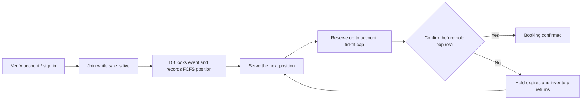

# Project map and how Fair Drop works

## The parts

| Part | Where it lives | Responsibility |
| --- | --- | --- |
| Frontend pages | `src/app/` | Landing page, buyer queue, organizer console, and protected-sale pages. These are Next.js pages. |
| UI components | `src/components/fairdrop/` | Reusable interface pieces: landing header, buyer actions, queue experience, admin console, protected-sale controls, and Fairness Lab. |
| API / backend | `src/app/api/` | HTTP endpoints called by the browser for joining, status, reservations, checkout, organizer actions, and simulations. They run on the server as Next.js route handlers. |
| Business rules | `src/lib/` | FCFS position assignment/admission (`event.ts`, `queue-operations.ts`), quantity-limited ticket holds and confirmation (`checkout.ts`), buyer/event state, organizer actions, sessions, abuse controls, and Fairness Lab orchestration. |
| Database | `db/schema.sql`, `src/lib/db.ts`, `supabase/` | Tables and constraints for events, entries, reservations, orders, audit events, rate limits, and simulation runs. Local development uses PGlite; hosted use connects to Supabase PostgreSQL. |
| Demo and checks | `scripts/` | Seed isolated fixtures, run API verification flows, and inspect database invariants. |

## Main buyer flow

1. In local development, buyers select a demo account. Hosted buyers create a Supabase Auth account and must verify their email.
2. A join request locks the event row, atomically increments the event's next-position counter, and creates one queue entry with a server timestamp. Rejoining returns the original place and does not move the buyer forward.
3. The next line positions are admitted in ascending position order. The default capacity is one active admission, so one buyer has a short time to reserve seats before the next place is served.
4. The buyer selects a quantity up to the event cap (4 by default). A database transaction checks account history and available inventory, then records the reservation quantity and moves the same quantity from available to reserved.
5. Confirmation moves the held quantity to sold and records one order. An expired or abandoned hold returns all held seats to available inventory. Idempotency records make retries safe.

## API areas

- **Buyer:** `src/app/api/session`, `src/app/api/demo-accounts`, `src/app/api/events/[id]`, and its `join`, `me`, and `reserve` routes.
- **Checkout:** `src/app/api/reservations/[id]/confirm`.
- **Organizer:** `src/app/api/admin/events/[id]` and subroutes for opening/closing entry, starting the sale, admission, metrics, holds, and demo reset.
- **Fairness Lab:** `src/app/api/admin/events/[id]/lab` and `lab/run`.
- **Protected event flow:** `src/app/api/protected/events/[id]` plus attendee invitations and organizer review routes.

## Abuse controls and what they mean

The app includes verified email (when required in Supabase Auth), optional Turnstile CAPTCHA, per-account limits, optional trusted-IP limits, duplicate-entry protection, organizer-only actions, signed sessions, server-checked admission, idempotency keys, expiring holds, a four-ticket-per-account default, and database transactions around inventory. The FCFS position is assigned under an event-row lock, so simultaneous join requests serialize through the database. Its scheduler route `POST /api/cron/process-queues` uses a constant-time shared-secret check. Configure an external scheduler to call it periodically with `Authorization: Bearer <CRON_SECRET>`; it advances expired turns and closes the event at the cutoff.

Demo account selection is intentionally open, so it does not prove one human per account. Email and CAPTCHA make automated abuse harder but do not constitute proof of one human per account or a complete bot/Sybil defense. Protected-sale invitations and organizer eligibility review are available for higher-assurance access. Strict FCFS means faster accepted entries get an earlier place; the CAPTCHA, rate limits, per-account cap, and admission checks reduce abuse but cannot eliminate network-speed advantages or account farms. Checkout is simulated, not a payment provider.

## Fairness Lab and evidence

The organizer Fairness Lab creates an isolated event, sends simulated buyer requests through the app's HTTP API, and compares the outcomes with a labeled first-request-wins model. It reports cohort allocations, throttled requests, inventory/order integrity checks, and API latency. A seed makes a lab run repeatable.

The current simulator is deliberately bounded to 6–24 logical buyers, up to 24 tickets, and at most 8 concurrent requests. It now exercises the same FCFS line and quantity-aware inventory rules as the app. Treat its output as functional evidence at demo scale, not a capacity benchmark. The schema and paginated organizer UI are designed to store 10,000+ entrants, but the event lock serializes FCFS admissions and the project has not been load-tested on live Supabase. Run a deployment-like adversarial load test before promising 10,000 concurrent users or a specific request rate.

## Supabase production setup

Create the project and configure Supabase Auth email confirmation and allowed redirect URLs first. Apply `db/schema.sql`, `supabase/migrations/20261004_auth_accounts.sql`, and `supabase/secure-tables.sql`, in that order. Configure `.env.local` from `.env.example` and set the Supabase public URL/publishable key, a private PostgreSQL transaction-pooler URL, `SESSION_SECRET`, and `ADMIN_SECRET`. Production startup will not apply schema automatically. The default account cap is in `events.max_tickets_per_account` and can be changed per event by an organizer or trusted database migration.

Set up a Turnstile widget and configure the matching secret both in Supabase Auth CAPTCHA settings and the server's `TURNSTILE_SECRET_KEY`; add `NEXT_PUBLIC_TURNSTILE_SITE_KEY` and the expected host name. The browser receives only the Supabase publishable key. Do not expose the PostgreSQL URL, CAPTCHA secret, or session/admin secrets.

Useful primary references: [Supabase plan limits](https://supabase.com/pricing), [Postgres connection pooling](https://supabase.com/docs/guides/database/connecting-to-postgres), [Auth CAPTCHA](https://supabase.com/docs/guides/auth/auth-captcha), and [free project pausing](https://supabase.com/docs/guides/platform/free-project-pausing).

## Important files

- `src/app/page.tsx` — event landing page and the visual starting point.
- `src/app/queue/page.tsx` and `src/components/fairdrop/QueueExperience.tsx` — buyer queue/status experience.
- `src/app/admin/events/[id]/page.tsx` and `src/components/fairdrop/AdminConsole.tsx` — organizer controls and metrics.
- `src/components/fairdrop/FairnessLab.tsx` — simulation form and evidence display.
- `src/lib/event.ts` — event-locked FCFS position assignment and join rules.
- `src/lib/queue-operations.ts` — ordered admission and cutoff controls; no random allocation.
- `src/lib/checkout.ts` — atomic quantity-limited reservations and confirmation rules.
- `src/lib/abuse.ts` — request limits and abuse audit records.
- `src/lib/db.ts`, `db/schema.sql` — database initialization and schema.
